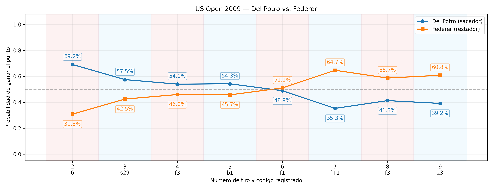

# Estimación de la probabilidad condicional de ganar un punto en tenis profesional

* **[PDF - Paper](barra_ventaja_tenis_Soler_Federico_v12.pdf)**

Modelo XGBoost que infiere tiro a tiro la probabilidad condicional de que el jugador al servicio gane el punto.

* **[Google Colab - Pipeline completo](https://colab.research.google.com/github/federicosolerup/barra_ventaja_tenis/blob/main/Untitled0.ipynb)**

Overlay sobre un punto televisado. 

* **[Video - YouTube](https://youtu.be/8rofKJLzumg)**

---

## Caso de Estudio

---

## Métricas obtenidas

Evaluación sobre 722.280 tiros correspondientes a 970 partidos del conjunto de prueba. El Dummy Uniforme genera predicciones aleatorias y asigna una probabilidad constante de 0,50. El Dummy Mayoría predice siempre la victoria del sacador. Los tres modelos XGBoost, con ventanas de uno, dos y tres tiros, se entrenaron y evaluaron sobre el mismo conjunto de prueba.

| Modelo | Accuracy | AUC-ROC | Brier Score | ECE | Precision (Sacador) | Recall (Sacador) | F1-Score (Sacador) |
| :--- | :---: | :---: | :---: | :---: | :---: | :---: | :---: |
| Dummy Uniforme (aleatorio) | 50.01% | 50.00% | 0.2500 | 7.18% | 57.19% | 50.02% | 53.37% |
| Dummy Mayoría | 57.18% | 50.00% | 0.2448 | 0.18% | 57.18% | 100.00% | 72.76% |
| XGBoost (t) | 60.87% | 64.23% | 0.2288 | 0.31% | 62.84% | 77.23% | 69.30% |
| XGBoost (t, t-1) | 61.58% | 65.62% | 0.2248 | 0.50% | 63.47% | 77.30% | 69.70% |
| **XGBoost (t, t-1, t-2)** | **61.68%** | **65.78%** | **0.2244** | **0.60%** | **63.55%** | **77.35%** | **69.77%** |
