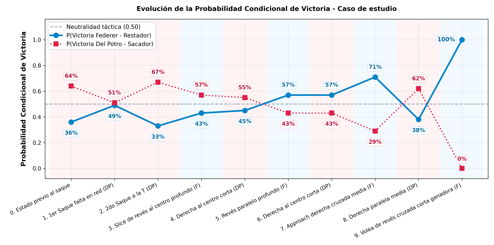

# Estimación de la probabilidad condicional de ganar un punto en tenis profesional

* **[PDF - Paper](barra_ventaja_tenis_Soler_Federico_v9.pdf)**

Modelo XGBoost que infiere tiro a tiro la probabilidad condicional de que el jugador al servicio gane el punto.

* **[Google Colab - Pipeline completo](https://colab.research.google.com/github/federicosolerup/barra_ventaja_tenis/blob/main/pipeline.ipynb)**

Aplicación web que permite introducir una secuencia de golpes y analizar la probabilidad de victoria.

* **[Simulación Web Interactiva](https://federicosolerup.github.io/barra_ventaja_tenis/HTML/index.html)**

Overlay sobre un punto televisado. 

* **[Video - YouTube](https://www.youtube.com/watch?v=PUkFia3wEEY)**

---

## Caso de Estudio: Juan Martín del Potro vs. Roger Federer

---

## Métricas obtenidas

| Modelo | Accuracy | AUC-ROC | Brier Score | Log Loss | ECE | Precision (Sacador) | Recall (Sacador) | F1-Score (Sacador) |
| :--- | :---: | :---: | :---: | :---: | :---: | :---: | :---: | :---: |
| Dummy (p = 0,50) | 50.00% | 50.00% | 0.2500 | 0.6931 | 6.70% | 56.70% | 50.00% | 53.14% |
| Dummy (p = 0,567) | 56.70% | 50.00% | 0.2455 | 0.6842 | 0.16% | 56.70% | 100.00% | 72.37% |
| XGBoost (t) | 59.40% | 61.04% | 0.2364 | 0.6653 | 0.14% | 61.42% | 76.33% | 68.07% |
| XGBoost (t, t-1) | 60.34% | 63.77% | 0.2302 | 0.6508 | 0.39% | 62.25% | 76.34% | 68.58% |
| **XGBoost (t, t-1, t-2)** | **60.51%** | **64.10%** | **0.2292** | **0.6484** | **0.48%** | **62.30%** | **76.89%** | **68.83%** |

---

## Cita y Referencias Académicas

`ibtex
@misc{soler2026barratenis,
  author       = {Federico Soler},
  title        = {Estimación de la probabilidad condicional de ganar un punto en tenis profesional},
  year         = {2026},
  howpublished = {https://github.com/federicosolerup/barra_ventaja_tenis}
}
`
