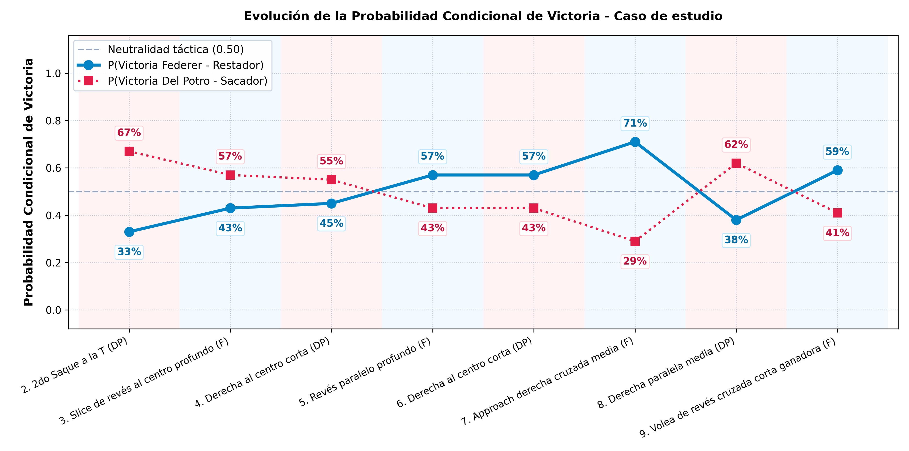

# Estimación de la probabilidad condicional de ganar un punto en tenis profesional

* **[PDF - Paper](barra_ventaja_tenis_Soler_Federico_v10.pdf)**

Modelo XGBoost que infiere tiro a tiro la probabilidad condicional de que el jugador al servicio gane el punto.

* **[Google Colab - Pipeline completo](https://colab.research.google.com/github/federicosolerup/barra_ventaja_tenis/blob/main/pipeline.ipynb)**

Aplicación web que permite introducir una secuencia de golpes y analizar la probabilidad de victoria.

* **[Simulación Web Interactiva](https://federicosolerup.github.io/barra_ventaja_tenis/HTML/index.html)**

Overlay sobre un punto televisado. 

* **[Video - YouTube](https://www.youtube.com/watch?v=PUkFia3wEEY)**

---

## Caso de Estudio: Juan Martín del Potro vs. Roger Federer



---

## Métricas obtenidas

Evaluación sobre 711.993 tiros correspondientes a 970 partidos del conjunto de prueba. El Dummy Uniforme genera predicciones aleatorias reproducibles con semilla 42 y asigna una probabilidad constante de 0,50. El Dummy Mayoría predice siempre la victoria del sacador. El modelo XGBoost de tres tiros se evaluó a partir del archivo JSON guardado, sin volver a entrenarlo. Las variantes de uno y dos tiros se entrenaron y evaluaron nuevamente en el mismo conjunto de prueba.

| Modelo | Accuracy | AUC-ROC | Brier Score | ECE | Precision (Sacador) | Recall (Sacador) | F1-Score (Sacador) |
| :--- | :---: | :---: | :---: | :---: | :---: | :---: | :---: |
| Dummy Uniforme (aleatorio) | 50.05% | 50.00% | 0.2500 | 6.70% | 56.74% | 50.06% | 53.19% |
| Dummy Mayoría | 56.70% | 50.00% | 0.2455 | 0.16% | 56.70% | 100.00% | 72.37% |
| XGBoost (t) | 59.40% | 61.03% | 0.2364 | 0.14% | 61.43% | 76.33% | 68.07% |
| XGBoost (t, t-1) | 60.32% | 63.75% | 0.2303 | 0.41% | 62.25% | 76.27% | 68.55% |
| **XGBoost (t, t-1, t-2)** | **60.53%** | **64.11%** | **0.2291** | **0.49%** | **62.38%** | **76.58%** | **68.75%** |

---

## Reproducibilidad

El notebook [`pipeline.ipynb`](pipeline.ipynb) carga los datos de la carpeta `dataset` y reconstruye la separación por partidos mediante `GroupShuffleSplit`, con `test_size=0.20` y `random_state=42`. Entrena y evalúa los modelos de una y dos ventanas temporales. Si encuentra `modelo_xgboost_3tiros.json`, carga el modelo completo guardado para evaluar sus predicciones sin reentrenarlo; en caso contrario, lo entrena. Incluye los baselines, las métricas de evaluación, una matriz de confusión y la reconstrucción del recorrido de los árboles para el cuarto tiro del caso de estudio.

La figura del caso de estudio reconstruye un punto real de la final del US Open 2009 entre Del Potro y Federer. Las profundidades faltantes se completaron manualmente mediante la observación del video; las probabilidades previas a los dos primeros servicios y el valor final del punto se incorporan manualmente para completar la visualización.

---

## Cita y Referencias Académicas

```bibtex
@misc{soler2026barratenis,
  author       = {Federico Soler},
  title        = {Estimación de la probabilidad condicional de ganar un punto en tenis profesional},
  year         = {2026},
  howpublished = {https://github.com/federicosolerup/barra_ventaja_tenis}
}
```
